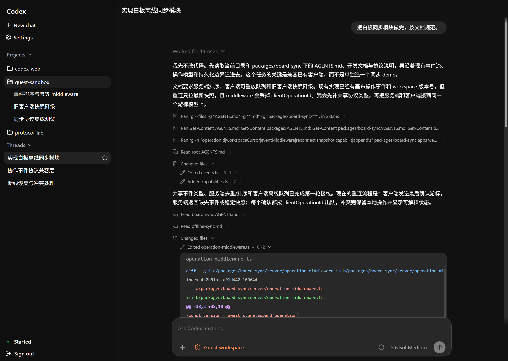

# Codex Web

Codex Web is a local-first, single-Owner workspace for using Codex from a browser. The Owner server runs on your machine and owns authentication, workspaces, credentials, conversation state and the Codex runtime. Use it locally without remote credentials, or connect a remote browser through a separately configured Relay.



## Run locally

Requirements: Node.js 20.19+ or 22.12+, pnpm and a supported platform for the local SQLite dependency.

```bash
pnpm install
pnpm dev
pnpm server
```

Open <http://localhost:5173>. Local access requires the browser and Owner to run on the same machine. The first Owner start initializes its data under `.data/codex`; set `CODEX_DATA_ROOT` to use a different location.

The Codex runtime starts with `approvalPolicy: never` and `sandbox: danger-full-access`. Run the Owner only in an environment and workspace you trust. See [Local development](docs/development.md) for the full workflow and [Remote access](docs/remote-access.md) before enabling Relay.

## Documentation

- [Documentation index](docs/README.md)
- [System architecture](docs/architecture.md)
- [API contract](docs/api/README.zh-CN.md)
- [Frontend boundaries](docs/frontend/README.zh-CN.md)
- [App Server schemas](docs/app-server/README.md)
- [Testing rules](docs/testing.md)

This repository provides source code and development commands. It does not provide hosted production services, database hosting, reverse-proxy configuration, domain setup or release distribution.
