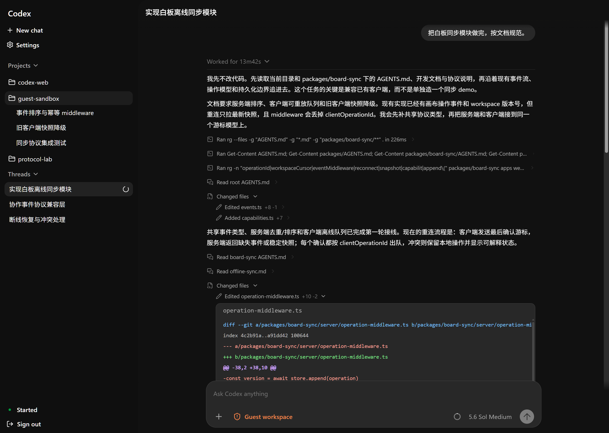

# Codex Web

Codex Web 是一个运行在本地 Web origin 上、由身份验证保护的单用户 Codex 工作台，支持桌面和移动端访问。

浏览器通过 Fastify Owner WebSocket 访问本机 Gateway；Owner 负责认证、runtime、workspace、history 和 Agent 控制。浏览器只接收安全投影，不接收 API key、宿主机路径或 runtime 进程信息。



## 运行要求

- Node.js 20.19+ or 22.12+
- pnpm
- SQLite（由 Owner 首次启动自动创建）

本项目提供源码、前端构建命令和本地服务启动命令。项目不提供生产环境、数据库托管、反向代理、域名配置或发行分发。

## 本地开发

克隆项目并进入目录：

```bash
git clone https://github.com/vixinox/codex-web.git
cd codex-web
```

复制环境配置：

```bash
pnpm install
cp .env.example .env
```

编辑 `.env`，确认 `BETTER_AUTH_SECRET`、`BETTER_AUTH_URL` 和 `BETTER_AUTH_TRUSTED_ORIGINS`。数据库文件位于 `CODEX_DATA_ROOT/owner.sqlite`。
首次运行 `pnpm server` 会为全新数据目录创建数据库，并在终端引导创建 Owner、绑定 TOTP 和保存恢复码；全部完成后才会启动服务。已有数据库不会自动迁移；需要时先运行 `pnpm db:push`，若需清空本地账户和数据再运行 `pnpm db:reset`。

远程控制需要单独部署 Relay，并将 `CODEX_REMOTE_RELAY_URL`（`wss://`）与 `CODEX_REMOTE_RELAY_OWNER_TOKEN`（至少 32 字符）配置到 Owner；Relay 服务配置相同取值的 `RELAY_OWNER_TOKEN`。Owner 只作为出站 WSS 客户端连接 Relay，不开放入站端口；TLS 在 Relay 或前置反向代理处终止。Relay 只做连接转发，不保存业务状态：重启会断开全部远程设备，Owner 连接短时中断不影响本地使用，客户端重连后由 Owner 的 snapshot/cursor 恢复 session 和事件状态。健康检查端点 `/healthz` 只返回 `{status, protocolVersion, connections}`，不含 node 或设备标识。Relay 限制均有安全默认值，可通过环境变量覆盖：`RELAY_MAX_CONNECTIONS`（10000）、`RELAY_MAX_CLIENTS_PER_NODE`（8）、`RELAY_MAX_FRAME_BYTES`（2097152）、`RELAY_MESSAGES_PER_SECOND`（250）、`RELAY_MAX_QUEUED_BYTES`（8388608）；监听地址由 `RELAY_HOST`（127.0.0.1）与 `RELAY_PORT`（8787）配置，服务以 `pnpm --filter @codex-web/relay dev` 启动。

在两个终端分别启动 Vite 和 Owner 服务：

```bash
pnpm dev
pnpm server
```

打开 <http://localhost:5173> 并使用 CLI 初始化时创建的 Owner 账户登录。

## 构建

```bash
pnpm build
```

该命令执行 TypeScript 构建检查并生成 Vite 前端产物。

## 常用检查

```bash
pnpm typecheck
pnpm test
pnpm test:frontend
pnpm test:server
pnpm exec oxfmt --check "**/*.{ts,tsx}"
```

## 文档

- [架构与安全边界](PROJECT.md)
- [Owner 远程架构](docs/owner-remote-architecture.md)
- [API 契约](docs/api/README.zh-CN.md)
- [前端边界与数据流](docs/frontend/README.zh-CN.md)
- [App Server 协议资料](docs/app-server/README.md)
