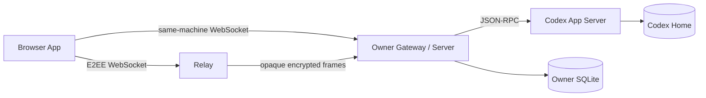
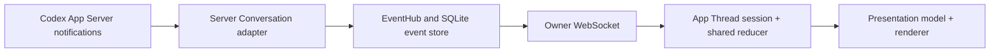

# 系统架构

Codex Web 是一个本地优先、单 Owner 的 Codex 工作台。Owner Server 是身份、业务授权、workspace、持久化与 Codex runtime 的权威边界。浏览器始终通过 Owner Gateway 访问业务能力；Relay 仅为远程连接转发加密流量。

## 系统拓扑

本机访问要求服务端验证 loopback peer、精确 Host 和 Origin，并以连接作用域的内存 admission 授权。远程访问需要一次性 Owner enrollment、已登记设备和设备绑定的有效 session；已知设备可用 Passkey 重新认证。Relay 不验证 Owner 业务方法、不存储对话内容或设备业务状态。完整认证契约见 [Owner 远程架构](owner-remote-architecture.md)。

## Workspace packages

| Package | 职责 | 主要依赖方向 |
| --- | --- | --- |
| `packages/app` | React/Vite 浏览器工作台、连接入口、Conversation 状态消费与展示 | `conversation`, `protocol`, `telemetry` |
| `packages/server` | Fastify Owner Gateway、Owner application、Codex runtime 管理与本机持久化 | `conversation`, `protocol`, `telemetry` |
| `packages/relay` | Bun/Hono WebSocket 路由及容量、连接生命周期管理 | `protocol`, `telemetry` |
| `packages/protocol` | Owner 与 Relay wire parser、验证、加密和共享契约 | `conversation`, `telemetry` |
| `packages/conversation` | 跨 Server 与 App 的类型化 Conversation model 和状态转换 | 无 workspace package 依赖 |
| `packages/telemetry` | 跨运行时 logger 和诊断错误契约 | 无 workspace package 依赖 |

应用 package 依赖共享契约包；共享契约包不反向依赖 App、Server 或 Relay。package manifest 是依赖关系的事实来源。

## Conversation 数据流

打开 Thread 时，Owner 读取 Codex transcript 快照并返回对应的 watermark；App 从 watermark 之后订阅类型化 Conversation changes。Server 持久化 `conversation_events` 中的类型化 change；App session 通过共享 reducer 合并快照和增量，再将 UI-facing presentation model 交给 renderer。cursor 失效时重新读取权威快照，不把原始 App Server DTO 直接交给页面。接口细节见 [API 契约](api/README.zh-CN.md) 和 [前端边界](frontend/README.zh-CN.md)。

## 数据与状态所有权

| 状态或数据 | 权威所有者 | 说明 |
| --- | --- | --- |
| Owner 身份、Passkey 公钥凭据、设备、session、Project、Credential、控制面事件 | Owner Server，`CODEX_DATA_ROOT/owner.sqlite` | 由 Server 授权和持久化；凭据加密密钥单独保存于数据根目录。 |
| Conversation change 历史 | Owner Server SQLite `conversation_events` | 保存有界、类型化的 change，不保存原始 JSON-RPC。 |
| Thread transcript | Codex Home | 由 Codex App Server 管理；不在 Owner SQLite 中保存原始 transcript。 |
| Codex runtime 安装与版本状态 | Owner 管理的 runtime 目录 | Server 管理安装、校验和切换；与 Codex Home transcript 分开。 |
| Relay 连接与路由 | Relay 进程内存 | 重启断开远程连接；不作为业务数据或离线事件存储。 |
| 远程连接 profile 与设备私钥 | 浏览器本地安全存储 | session 按当前浏览器 profile 保存并受保护。 |
| Thread 的 UI 消费状态 | App Thread session | 来自 snapshot/change；是界面投影，不取代 Server/Codex 权威数据。 |

## 代码入口

- `packages/server/src/owner/server.ts`：Owner 服务启动和依赖组合。
- `packages/server/src/owner/app.ts` 与 `owner/runtime.ts`：Owner 应用服务和 WebSocket runtime 组合边界。
- `packages/server/src/codex/`：Codex process、runtime manager、Conversation adapter 和事件存储。
- `packages/relay/src/main.ts`：Relay listener 与路由启动。
- `packages/app/src/app/entry/`：浏览器路由与启动入口。
- `packages/app/src/app/chat/session/`、`projection/` 和 `ui/`：Thread 状态、展示模型和 renderer。

各模块的状态所有权和拆分规则见 [Server 模块规则](../packages/server/AGENTS.md)；本机和远程认证约束见 [Owner 远程架构](owner-remote-architecture.md)。
